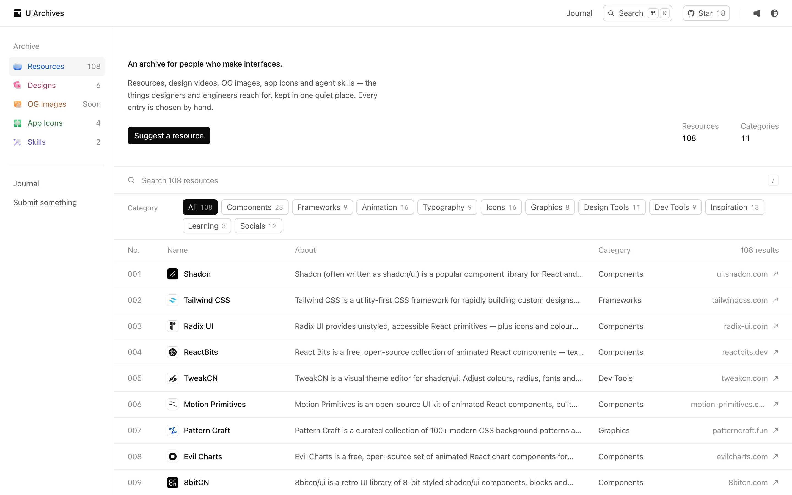
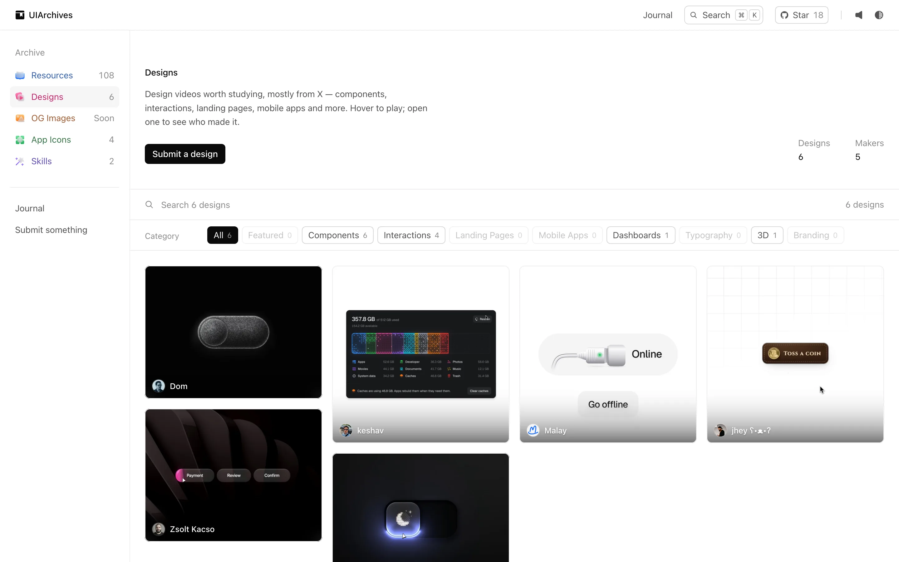
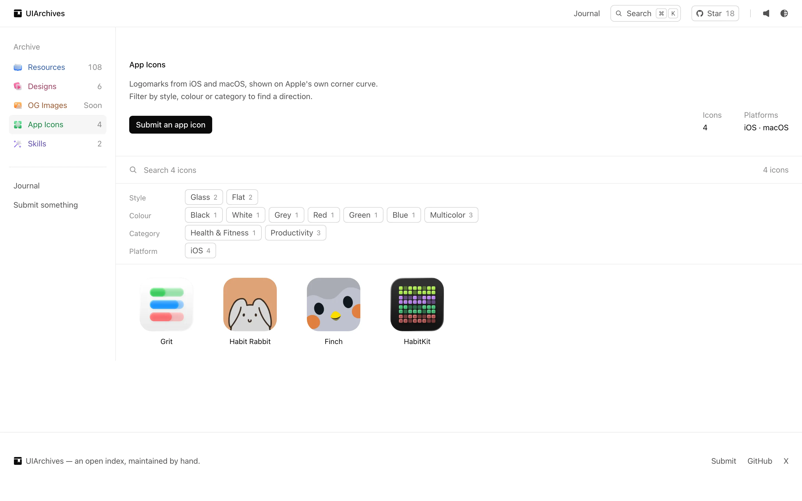

# UIArchives

An archive for people who make interfaces.

Resources, design videos, OG images, app icons and agent skills — the things designers and engineers reach for, kept in one quiet place. Every entry is chosen by hand.

**[uiarchives.com](https://uiarchives.com)**



## What's inside

| Section | What it is |
| --- | --- |
| **Resources** | Tools, component libraries, typefaces, icon sets, design and dev tools, references and people worth following — one link each, filterable by category. |
| **Designs** | Short design videos from designers on X: components, interactions, landing pages, mobile apps, dashboards, typography, 3D and branding. |
| **OG Images** | Open Graph cards that introduce their product well — the image a link becomes when shared. |
| **App Icons** | iOS and macOS icons with a strong mark, filterable by style and colour. |
| **Skills** | Agent skills that teach design and frontend craft, with copy-ready install commands. |



## Features

- **Search everything** with <kbd>⌘</kbd> <kbd>K</kbd> — resources, categories, journal posts and actions.
- **Filters that match the content** — a category per section, counts on every option.
- **Details without leaving the page** — a side panel for resources, a centred viewer for design videos, with ← → to browse.
- **Light and dark**, small click sounds (optional), and layouts that hold up from phones to wide screens.
- **Submissions** — anyone can suggest something at [/submit](https://uiarchives.com/submit). Every entry is reviewed before it appears, and the submitter is emailed when it's approved or declined.
- **A steady supply of candidates** — every six hours the site checks the App Store, GitHub and Hacker News, and a daily Claude agent looks for standout finds. Everything lands in the private review queue; nothing is published automatically.



## Built with

- [vinext](https://github.com/cloudflare/vinext) — the Next.js App Router API on Vite, running on **Cloudflare Workers**
- **Cloudflare D1** (submissions and review queue), **Workers KV** (stored media) and **Cron Triggers** (the six-hourly crawl)
- [Tailwind CSS](https://tailwindcss.com) v4, [Geist](https://vercel.com/font) and [Motion](https://motion.dev)
- [Nucleo](https://nucleoapp.com) icons
- MDX for the journal
- Passkeys ([SimpleWebAuthn](https://simplewebauthn.dev)) for the private review page, Gmail SMTP for email

Everything runs on free plans.

## Running locally

```bash
git clone https://github.com/Malay146/UIArchives.git
cd UIArchives
npm install
npm run dev        # http://localhost:3001
```

The dev server runs the Worker locally, with local D1, KV and cron. Local secrets go in `.dev.vars` (git-ignored); without them, emails are logged to the console instead of sent.

Create the local tables once by running the SQL files in [`migrations/`](migrations) against the local database, then trigger the crawl whenever you like:

```bash
curl -X POST "http://localhost:3001/cdn-cgi/local/explorer/api/local/scheduled?worker=uiarchives" \
  -H "content-type: application/json" -d '{"cron":"0 */6 * * *"}'
```

## Deploying

```bash
npx cf auth login     # once
bash scripts/go-live.sh
```

The script keeps secrets in `.cloudflare-secrets` (git-ignored), builds, deploys the Worker and applies any new database migrations. See [docs/cloudflare-setup.md](docs/cloudflare-setup.md) for the full setup: secrets, passkey sign-in, email, DNS and the daily agent.

## Project layout

```
app/                 routes — sections, /submit, /review, /blog, API routes
components/          UI — collection views, sheet/viewer, command menu, site chrome
content/blog/        journal posts (MDX)
data/                hand-curated entries for each section
lib/                 section schemas, search, sounds, server code (D1, KV, auth, email, crawl)
migrations/          D1 schema
automation/          instructions for the daily Claude curator
scripts/             deploy, DNS and asset scripts (logos, snapshots, metadata)
```

## Contributing

The easiest way to contribute is to [submit something](https://uiarchives.com/submit) worth adding. Bug reports and pull requests are welcome too.

If UIArchives is useful to you, a star on GitHub helps others find it.
